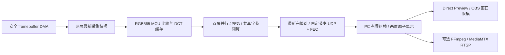

# 开发总结与复现

[返回直播首页](README.md) · [使用教程](USAGE.md) · [完整研究记录](RESEARCH.md) · [协议](PROTOCOL.md)

## 结论与演进

已形成可测试的 New 3DS 双屏直播链路：沿用 3ds-recorder 安全抓屏路径，JPEG 4:2:0 双屏共享预算，独立核心编码、精确 DCT 缓存、固定节奏 UDP、分条带 XOR 冗余、PC 成对显示。用户认可 R6 靠近路由器时的画质、同步和流畅度。R7 完成窗口易用性和 0.4–2 MB/s / 15–30 FPS 档位扩展，保留 30 FPS / 1 MB/s 默认值。

| 阶段 | 观察与修正 |
| --- | --- |
| 初版 / R2 | LTC1 低复杂度方案画质不足；切入 JPEGENC。R2 两屏编码均值约 22.45 / 18.18 ms，发送排队仍丢帧 |
| R3 | 逐包节奏从调用开始计费，包含 SOC IPC 时间，消除额外叠加等待；编码/提交接近 24 FPS，PC 仍有缺片 |
| R4 | 双屏编码分别尝试核心 2、3；单纯并行未解决网络及调度抖动，用户反馈退步 |
| R5 | 尝试根据反馈调低编码预算；下屏 4013/7869 次超预算，固定分屏份额加质量下限导致严重不同步 |
| R6 | 固定总预算、两屏共享量化、缓存 DCT、有界重编码、共同帧号与原子显示、FEC；用户确认效果明显改善 |
| R7 | 保留 R6 数据路径；纯黑预览、可隐藏紧凑控制栏、友好 MB/s 档位、能力通告、提高缓冲和参数上限、配套文档与安装包 |

R6 连续 60.033 秒真机记录：两屏完整接收平均 29.767 FPS，5 秒窗口 29.552–29.997，IPv4 平均 906605 B/s，解码错误 0，恢复 24 个分片，未完成 14 对。用户位置与场景并非覆盖所有游戏的标准基准，不能推广为任何条件下严格 30 FPS 或零延迟。R7 新上限仍待真机测试，不能把 R6 数据作为 2 MB/s 结果。

## 编码与传输设计



1. 保留上游 DMA 和画面稳定性判断。快照等待两屏最新请求的采集完成，再赋共同序号及复合采样 PTS；不能要求“没有待处理 DMA”才采样，否则持续换屏可使双屏配对饥饿。游戏本身可能异步渲染或停止换屏，复用次数另记。
2. ARM11 为 ARMv6，不支持 NEON。当前使用整数颜色转换/DCT，编码线程分别尝试核心 2、3，创建失败回退核心 1；这些核心仍与游戏/系统共享，不能当作四个专用编码核心。
3. 比较 16×16 RGB565 MCU；像素完全一致则复用未量化 DCT。每次仍输出完整 JPEG，避免网络差分参考在丢包后污染后续帧。缓存节省计算，不自动节省网络字节。
4. 两屏共享总 JPEG 额度和质量参数，复杂下屏可以占更多份额。超预算最多追加两次量化/熵编码，复用 DCT，最后一次用 Q1；仍不合格则整对跳过。未承诺任意高噪声内容均可在最低带宽内装下。
5. 队列只保留最新待发对；交错发两屏数据，每屏两个 XOR 条带包。每条带最多恢复一个缺片，不重传；发送期限是一帧周期。固定限速包含应用头、IPv4/UDP、冗余和状态，并留 4% 预算余量，不累计空闲发送额度。
6. PC 最多缓存两对、80 ms 超时，防止旧帧积压；只有两屏都解码成功才更新画面。不恢复的丢包会丢整对，以同步和低等待为优先。
7. R6CF 在发送对之间改变目标 FPS/字节上限，配置代号让旧配置的编码/待发对失效。R7ST 增加最大带宽与 FPS 位图，PC 不会向 R6 提供无法生效的高档位。

“固定码率”在此指固定总字节上限和发包节奏，不添加填充数据。内容质量调节继续在固定预算内部工作，R5 的反馈降总预算算法不再启用。更高带宽改善每对画面可用字节，不能自动提高采集/编码能力；60 FPS 必须另测 16.7 ms 周期和游戏后台余量。

R7 将每屏 JPEG 容量从 40000 提升到 128000 B，使 15 FPS / 2 MB/s 下大部分双屏额度可供一个复杂屏幕使用。新模块 text+data+BSS 为 4,388,672 B（BSS 4,102,376 B），比 R6 多约 704 KB；这不是系统模块全部运行内存，仍需在真机游戏中验证。

## 文件与产物

| 路径 | 职责 |
| --- | --- |
| `sysmod/source/live_stream.c` | 双屏任务、最新队列、发包、配置、状态 |
| `codec/source/live_jpeg.c` | JPEGENC 适配、精确 MCU 比较、DCT 缓存与量化 |
| `codec/include/live_pair.h` / `live_pacing.h` | 共享预算与逐包节奏 |
| `live/pair_protocol.py` | 组帧、FEC、界限与序号规则 |
| `live/receiver.py` | 接收、解码、配置往返、统计、可选 RTSP 输出 |
| `live/preview_ui.py` / `preview.pyw` | 纯黑窗口、设置与快捷键 / 双击入口 |
| `live/build.py` / `build_app.py` | PC 编解码库及独立基准 / 完整模块与控制应用 |
| `live/package.py` | 本地安装包、配套 PC 工具与 SHA-256 清单；不安装或上传 |

应用包含模块和启动插件，构建顺序必须是 sysmod → plugin → app，以更新共享地址头；旧控制应用不能随意搭配新模块。Windows 测试包携带的 `livecodec.dll` 只依赖 KERNEL32 和 msvcrt，不要求目标机安装 MinGW。其他平台需自行构建，未做对应发布包验收。

## 构建与测试

源码环境需 Git 子模块、Python/Pillow、GCC/MinGW-w64。完整 3DS 应用还需要 devkitARM、libctru、citro2d/3d、makerom、3gxtool；上游工具配置见仓库 `tools/Dockerfile`。Windows 包的普通用户只需按使用教程准备 Python 依赖。

在仓库根目录：

```powershell
git submodule update --init --recursive
python -m pip install -r .\live\requirements.txt
python .\live\build.py
python -m unittest discover -s live -p 'test_*.py'
python .\live\qa_preview.py
python .\live\qa_pair.py --fps 30 --rate 2000000
python .\live\qa_pair.py --fps 15 --rate 2000000
python .\live\qa_pair.py --fps 20 --rate 400000
python .\live\qa_pair.py --legacy-status --fps 24 --rate 1000000
```

`build.py` 会运行 C 编解码边界、节奏、历史自适应和共享预算测试。`qa_preview.py` 需要桌面会话，检查真实 Tk 布局、隐藏恢复、持久化、能力档位和应用参数。`qa_pair.py` 使用独立回环 UDP 端口、合成 JPEG 和人工缺片，不连接真机。

正在运行的 Windows 预览可能占用旧 DLL。无需停止它，可独立构建和验证：

```powershell
python .\live\build.py --output-dir .\live\build\r7
$env:LIVE_CODEC_LIBRARY=(Resolve-Path .\live\build\r7\livecodec.dll).Path
python -m unittest discover -s live -p 'test_*.py'
```

`LIVE_CODEC_LIBRARY` 仅影响当前进程环境及子进程，关闭该终端或移除此环境变量恢复默认库路径。RTSP 测试需要 FFmpeg/FFprobe 与 MediaMTX，且本机 8554 可用：`python .\live\qa_rtsp.py`。它使用独立 UDP 端口，仅清理自己创建的子进程。

Windows 完整应用构建使用本机已有 SDK 和 MSYS2，参数指定真实路径，例如：

```powershell
python .\live\build_app.py --sdk C:\devkitPro --bash C:\msys64\usr\bin\bash.exe --tool-bin .\live\build\tools
```

本项目现有开发机也可直接运行 `python .\live\build_app.py` 使用脚本默认路径。脚本不安装全局工具，生成 `sysmod/rec3ds.cxi`、`app/3ds-recorder.3dsx` 等。已有兼容 shell 中可按顺序执行 `make -C sysmod`、`make -C plugin`、`make -C app APP_CHANNEL=live-r7`。

打包（`--host` 为部署时 PC 地址）：

```powershell
python .\live\package.py --stream-only --host 192.168.0.10 --profile fixed30
```

使用候选 DLL 时追加 `--codec-library .\live\build\r7\livecodec.dll`。产物 `live/dist/new3ds-live-r7.zip` 包含 SD 内容、PC 工具、文档、许可证和各文件哈希；Manifest 记录源代码提交和工作区是否有改动。交付先提交、再构建打包，运行 `python .\live\qa_package.py` 验证清单、包内链接、独立 DLL 和窗口启动。日志、私有测量、IP 设置和二进制包由 `.gitignore` 排除，不进入源码提交。

## R7 本轮验证与后续验收

- 完整 ARMv6K 模块、插件和控制应用构建成功，无编译警告。
- 27 项 Python 测试通过：JPEG 边界/颜色/缓存一致性/并发，大于 40 KB 的高细节 JPEG、128000 B 容量哨兵，以及丢包、重排、会话重启、序号回绕、配置与能力通告。
- C 共享预算测试遍历 15/20/24/30 FPS、0.4–2 MB/s 码率及每种双屏字节分配，计入头部、冗余和状态。
- 本机 UDP 测得 30/2M、15/2M、20/0.4M、旧 R6 24/1M 接收接近各自目标，注入缺片可恢复，解码错误 0。不同测试使用适配预算的合成输入，不能作为 ARM 编码或真实 Wi-Fi 性能结果。
- Tk 检查控件显示时内容为 400×547，隐藏后 400×480；图像不缩放，恢复菜单仍可用，R6/R7 档位和持久化正常。窗口截图工具返回 `window capture timed out`，没有用截图宣称完成视觉验收。
- RTSP 回归通过：FFprobe 识别 H.264、400×480、30/1，3 秒读取 89 帧；这不代表新增的真机采集档位已经验收。

下一轮按[使用教程](USAGE.md)由用户安装 R7，在相同游戏、位置下先复测 30/1M，再依次测 1.2–2M；保留每档 60–120 秒数据。另测 24、20、15 FPS、动态切换、关闭/重开预览、丢包恢复和回退。记录设备编码时间、发送超时、PC 完整对率、用户画质/延迟体感，并区分静态复用和实际游戏新帧。绝对延迟需真机与 PC 同框视频，OBS 需实际 UI 验收。当前仍以 R6 的真机结果为已验证基线。

旧 `arm_bench.c` 可通过 `build.py --arm --sdk …` 生成独立 `live-bench.3dsx`，`analyze_bench.py` 分析导出的 CSV；它只测基础 LTC1/JPEG，不覆盖 R6/R7 后台双屏流水线。`evaluate.py` 是离线质量对照，没有 ARM 性能含义。它们是研发诊断工具，不是用户推流的前置步骤，也不包含在精简直播安装包中。

## 参考与归属

MIT 主项目和 Apache-2.0 JPEGENC 的许可证随包保留；JPEGENC 子模块固定于 Git 记录的提交。本分支添加 framebuffer 适配、缓存和码率控制，不将概念参考声称为代码复用。协议/硬件及 NTR-HR 的原始参考链接与限制分析保存在[研究记录](RESEARCH.md)。
