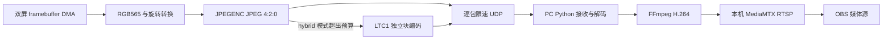

# New 3DS 双屏直播实验分支

目标：New 3DS 上屏 400×240、下屏 320×240 **各 30 个新画面/秒**、画面清晰、操作延迟尽量低，合计 IPv4 流量不超过 1,000,000 B/s，通过 PC 接入 OBS。24 FPS 保留用于对照。已完成 HOME 菜单推流测试，**尚未达到双屏实际接收 30 FPS，也未经过真机游戏运行验收，不能承诺目标性能**。首版只传视频，不传声音，不支持 800 像素宽屏模式。

上游基线：`BolgarMaxym97/3ds-recorder@2952a1df332a5c9c34938f5ba788b30cd57a2168`。开发分支：`feature/dual-screen-live`。保留原录制功能；只有 SD 上的 `live.ini` 有效且 `enabled=on` 时，开始录制操作才转为直播。

## 实现



默认 30 FPS、700,000 B/s，编码预算占 93%，按两屏像素数 400:320 分配，预留封包空间。live-r2 默认 `codec=jpeg`，每屏以细粒度质量参数控制 JPEG，**每帧只尝试一次**；超预算则丢掉当前帧并降低后续质量，避免再编码整帧 LTC1 的耗时和画质跳变。两屏轮流服务，每屏只保留最新待发帧，已完成 DMA 的旧帧也会被舍弃。UDP 无重传、无帧间依赖，丢包最多损坏当前屏的一帧。没有网络拥塞反馈或自动降帧功能。`codec=hybrid` 可显式启用 LTC1 回退，`codec=ltc1` 可单独诊断块编码。

`live-quality.ini.example` 是另一测试配置：24 FPS、800,000 B/s、JPEG。相比 30 FPS/700,000 B/s，每帧编码预算增加约 43%，仍需验证所在网络能否承受该速率。

R4 使用两个独立的 JPEG 状态和编码线程，分别尝试 New 3DS 的核心 2、3，创建失败时回退核心 1。采集提交与编码解耦，每屏仅保留最新待编码和待发送帧；停止时等待工作线程退出再释放资源。`live-30.ini.example` 用于 30 FPS / 800,000 B/s 对照。并行编码是否提高真机帧率、是否影响游戏，需要依据每屏编码时间、实际核心和收帧统计判断。

带宽限制计入自定义头、IPv4 和 UDP 头；不包括 Wi-Fi MAC 开销、路由器缓冲和无线重传。RTSP 在 PC 本机产生，不占 3DS→PC 的这份预算。

## 可选：单独测真机编码耗时

可以直接按下面的“PC 与 OBS”和“安装实验系统模块并试游戏”做推流测试；独立编码基准不是前置条件，适合在帧率不足时定位编码开销。

在本机已构建的项目中，运行 `python live/package.py` 会生成 `live/dist/new3ds-live-test.zip`。解压后将 `sd-benchmark` 内的内容合并到 SD 根目录，在 Homebrew Launcher 启动 `live-bench.3dsx`。它不安装系统模块、不修改 Luma 配置，会写 SD 根目录 `/live-bench.csv`。样本文件存在时使用真实游戏视频的抽样画面，否则使用合成图案；控制台和包清单会注明。

复制 CSV 回 PC 后：

```powershell
Set-Location D:\Games\Old_Times\3ds\live_stream\3ds-recorder
python .\live\analyze_bench.py .\live-bench.csv
```

基准测量同一份 ARMv6K C 编码器，申请 New 3DS 804 MHz 模式，分别记录每屏 LTC1、四档 JPEG 和两档混合编码的均值、P95、最大耗时及预算成功率。JPEG `bytes=0` 表示超预算，不能当成成功帧。两屏编码耗时之和必须明显低于 33.33 ms（30 FPS）或 41.67 ms（24 FPS），才有余量留给转换、采集、网络与游戏。独立 homebrew 的耗时不能替代游戏后台测量。

## PC 与 OBS

已有构建的这台 PC：

```powershell
Set-Location D:\Games\Old_Times\3ds\live_stream\3ds-recorder
python .\live\run.py --sender 192.168.0.105 --fps 30 --stats .\live\build\received.csv
```

保持窗口运行。OBS 添加“媒体源”，取消“本地文件”，输入 `rtsp://127.0.0.1:8554/3ds`，输入格式可留空。若本机 OBS 的媒体源无法打开该地址，可用 VLC 视频源添加相同网络地址。上下屏合成 400×480，下屏水平居中，OBS 可裁剪成两个来源。降低网络缓存后检查稳定性。本轮已用 FFprobe 验证 RTSP，尚未在 OBS UI 中验收。

独立 VLC 测试时，关闭之前的流窗口，在另一个终端执行 `python live/play.py`，以 50 ms 网络缓存打开新实例；不要用默认约 1000 ms 的缓存评估操作延迟。若出现抖动可用 `--cache-ms 100`。这仅减少播放端缓存，不代表总延迟已经降到 50 ms。PC H.264 桥接使用 CRF 10、无 B 帧和立即刷新，避免再编码明显加重模糊。

用户在同源画面对照中确认直显窗口比低缓存 VLC 更跟手。优先评估低延迟时，可加 `--preview` 同时打开直显；或使用下面的命令只直显，省去 H.264/RTSP 播放链路。OBS 可先用“窗口采集”选择 `3DS Live - Direct Preview`（尚未在 OBS UI 验收）；原生 OBS 源插件仍未实现。

```powershell
python .\live\receiver.py --sender 192.168.0.105 --fps 30 --preview --no-output --stats .\live\build\received.csv
```

CSV 还记录缺失分片、未完成帧、乱序/迟到包和解码耗时。`arrival_lag_ms` 是相对本次会话最小到达延迟的增长量，不是端到端绝对延迟；绝对延迟仍需用真机和电脑同框视频测量。

Python 入站 UDP 8001 需要在 Windows 的当前局域网防火墙规则中允许；RTSP 8554 仅监听回环地址。`--sender` 填 3DS IP，SD 配置的 `host` 填 **PC IP**，不要写反。日志每 5 秒报告每屏实际收帧率、IPv4 B/s 和解码错误；输出时钟丢帧时会重复上帧，因此 OBS 显示 30 FPS 不代表真机有 30 个新画面。

不启动 RTSP、单独接收测量：

```powershell
python .\live\receiver.py --sender 192.168.0.105 --no-output --seconds 120 --stats .\live\build\received.csv
```

新 PC 需 Python、GCC/MinGW-w64、FFmpeg（含 libx264）和 [MediaMTX](https://github.com/bluenviron/mediamtx/releases)。本轮使用 MediaMTX v1.21.4；将其 Windows 可执行文件放到 `live/build/tools/mediamtx/mediamtx.exe`，或给 `run.py` 传 `--mediamtx`。然后：

```powershell
git submodule update --init --recursive
python -m pip install -r .\live\requirements.txt
python .\live\build.py
```

## 安装实验系统模块并试游戏

可直接进行此步。包的 `experimental-app/3ds-recorder.3dsx` 是包含本次系统模块的完整控制应用。也可执行 `python live/package.py --stream-only --host PC的IPv4地址`，得到 `live/dist/new3ds-stream-test.zip`，将其中 `sd-stream` 内的内容合并到 SD 根目录，应用和 `live.ini` 即已就位。先备份 SD 的 `/luma/sysmodules/0004013000F1D302.cxi` 和原应用；实验版沿用上游标题标识，不是独立安装槽位。原录制文件不需要迁移。

1. 将实验应用放在 SD `/3ds/`；将 `live.ini.example` 复制成 `/3ds/recorder/live.ini`，把 `host` 改成 PC 的局域网 IPv4 地址。默认 `codec=jpeg`、`fps=30`、`bytes_per_second=700000`。缺少此文件会进入原本的 SD 录制模式，不会发送网络视频。
2. 按上游安装方式，Luma 开启 **Enable loading external FIRMs and modules**；启动实验应用，让它安装更新系统模块，并按应用提示重启。该安装会替换原系统模块。
3. 启动 PC 接收器。进入游戏，按原热键 **R + SELECT** 开始/停止直播；热键若在原配置中改过则用改后的热键。关闭 3D，先测常规 400×240 上屏游戏。
4. 连续测 120 秒，两屏都需要有运动；停止后收集 PC `received.csv`、SD `/3ds/recorder/live-stats.txt` 和 Recorder 日志。固定画面本来不会每秒产生 30 个新画面；上游对静止 VRAM 只偶尔重抓，对静止 FCRAM 保留上一帧。
5. 同一场景分别测 `fps=30`、`fps=24`。编辑配置前先停止直播，重启模块/主机使配置可靠重载。必要时测 `codec=ltc1` 以区分 JPEG CPU 开销和网络问题。

建议先用 700,000 B/s：此前 FTP 前台吞吐均值仅约 875,000 B/s，最低一轮约 763,000 B/s，且游戏后台网络可能更慢。`bytes_per_second` 接受 620,000–1,000,000。这里的 1 MB/s 是十进制 8 Mbit/s。

如果启动失败或卡住，恢复备份模块并重启；不需要改动游戏。恢复普通录制时删除 `live.ini` 或设置 `enabled=off`；恢复原版模块后也恢复原版控制应用，两者共享地址必须配套。**SOC 在 sysmodule 中的初始化、与联网游戏共存、可用内存、模式切换及后台帧率均待真机验证。**

## 开发与复现

```powershell
python .\live\build.py --arm --sdk D:\Games\Old_Times\3ds\toolchain\sdk\opt\devkitpro
python -m unittest discover -s live -p 'test_*.py'
python .\live\qa_rtsp.py
python .\live\evaluate.py --images .\live\build\samples\frames
```

`build.py --arm` 生成 `live/build/live-bench.3dsx`；主机 C 测试覆盖字节预算、截断和畸形输入；Python 测试覆盖 JPEG 内存边界、颜色/方向、UDP 乱序/丢包/重启/序号回绕。`qa_rtsp.py` 使用预编码的合成双屏帧，输出实测 CSV 和 FFprobe JSON；这不是 ARM 编码性能测试。`evaluate.py` 不带 `--images` 时使用合成图案并覆盖当前 `quality.csv`。

完整应用在已有 devkitPro 环境构建：按顺序 `make -C sysmod`、`make -C plugin`、`make -C app`。需要 libctru、citro2d/3d、makerom、3gxtool；上游 `tools/Dockerfile` 固定了 3gxtool 源码版本。务必先构建 sysmod，以更新 app 的共享地址头文件。Windows 本机构建用法见 `build_app.py`。

设计依据、质量数据和验收门槛见 [RESEARCH.md](RESEARCH.md)；协议见 [PROTOCOL.md](PROTOCOL.md)。
